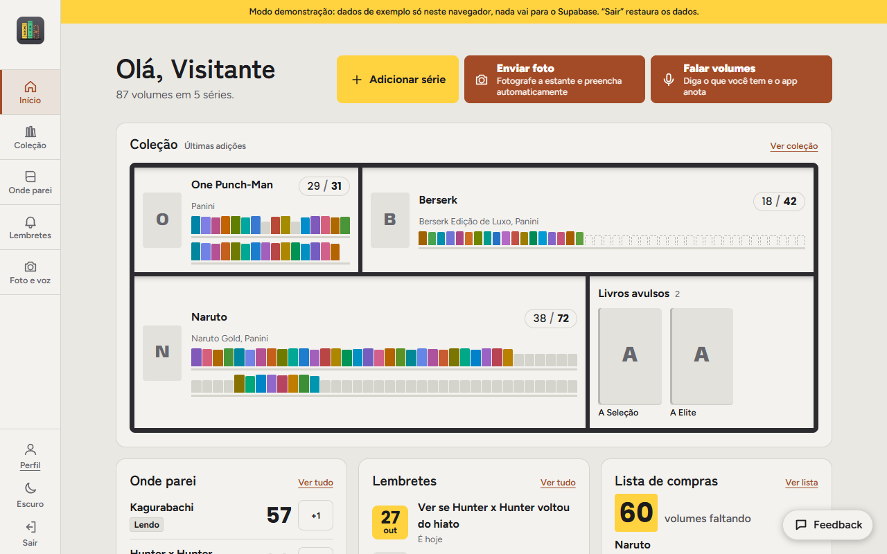
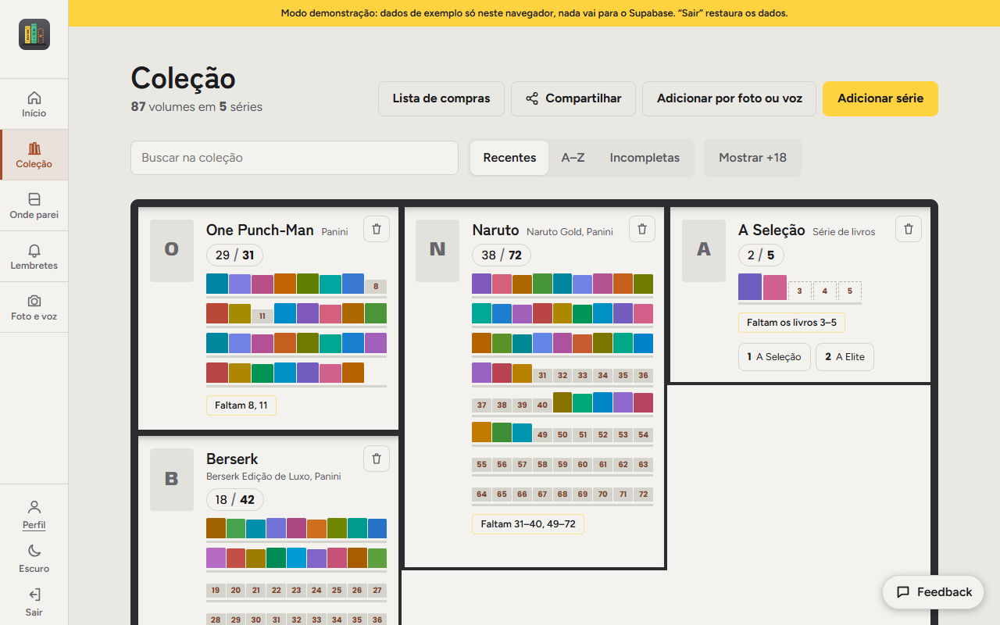
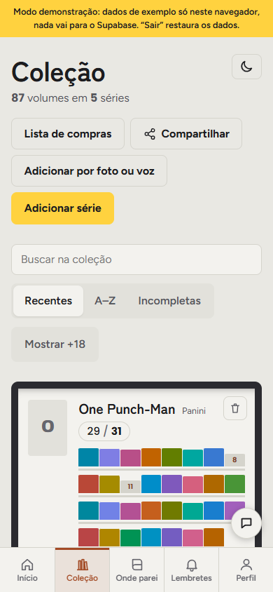

<h1 align="center">Lombada</h1>

<p align="center">
  Organize sua coleção de mangás e livros físicos, acompanhe o que está lendo online e cadastre a estante inteira por <strong>foto</strong> ou por <strong>voz</strong>, com IA.
</p>

<p align="center">
  <a href="https://lombada-app.meuslivros.workers.dev"><strong>Ver o app online</strong></a>
</p>

<p align="center">
  
  
  
  
  
  
</p>



## O que o app faz

- **Estante visual:** cada volume vira uma lombada colorida, e o que falta de cada edição aparece em destaque ("Faltam 31–40, 49–72").
- **Cadastro rápido:** manual, importação por CSV, **foto da estante** ou **voz** ("tenho Naruto do 1 ao 10, falta o 11"), com IA (Gemini) e sempre com uma tela de revisão antes de salvar.
- **Onde parei:** histórico de leitura online com status e lembretes por data.
- **Lista de compras** gerada a partir do que falta na coleção.
- **Compartilhamento** da estante por link, perfil com foto, tema claro e escuro, interface em português e responsiva.
- **Conta:** login com e-mail e senha (confirmação e redefinição por e-mail), painel de administração e envio de feedback.

| Coleção | No celular |
|---|---|
|  |  |

## Tecnologias

| Parte | Tecnologia |
|---|---|
| Front | React 19, TypeScript, Vite, React Router, TanStack Query |
| Backend | Cloudflare Workers (rotas `/api` e Worker com cron para lembretes) |
| Banco e login | Supabase (Postgres, Auth e Row Level Security) |
| IA | Gemini API (foto da estante e voz) |
| Catálogos | Google Books e Open Library |
| Deploy | Cloudflare, com publicação automática a cada push na `main` |

## Decisões de projeto

- **Segurança no banco:** toda tabela tem Row Level Security. As 18 migrations ficam em `supabase/migrations/` e `npm run test:rls` verifica as políticas.
- **IA no servidor:** as chamadas ao Gemini passam pelo Worker, que guarda a chave e aplica uma cota diária por usuário.
- **Privacidade:** as fotos da estante não são armazenadas.
- **Custo zero:** a stack inteira roda em planos gratuitos.

## Rodar localmente

```bash
npm install
cp .env.example .env.local   # preencha com os dados do Supabase
npm run dev                  # http://localhost:5173
```

Para ver as telas internas **sem criar conta**, use o modo demonstração (dados de exemplo só no navegador, nada vai para o Supabase):

```bash
npm run dev:demo             # http://localhost:5174
```

Para testar **foto e voz** localmente (Worker + Gemini):

1. Copie `.dev.vars.example` para `.dev.vars` e preencha a `GEMINI_API_KEY` (vem do AI Studio).
2. Em um terminal: `npm run pages:dev` (site e rotas `/api` pelo Worker, em http://localhost:8788).
3. Em outro: `npm run dev` e abra http://localhost:5173. As chamadas `/api` são repassadas para o 8788.

Para publicar a sua própria versão (Supabase, e-mail, Cloudflare, Gemini e lembretes), veja o [passo a passo de configuração](docs/configuracao.md).

## Testes

```bash
npm run test:logic   # lógica da IA no servidor e funções do front
npm run test:rls     # políticas de segurança do banco
```

## Estrutura

```
src/            app em React (páginas, componentes, consultas ao banco)
worker/         rotas /api no Cloudflare Worker (foto, voz, cota de IA)
workers/        Worker com cron dos lembretes
supabase/       migrations, modelos de e-mail e teste das regras de acesso
tests/          testes da lógica
```

## Licença

Código sob a licença [MIT](LICENSE).
